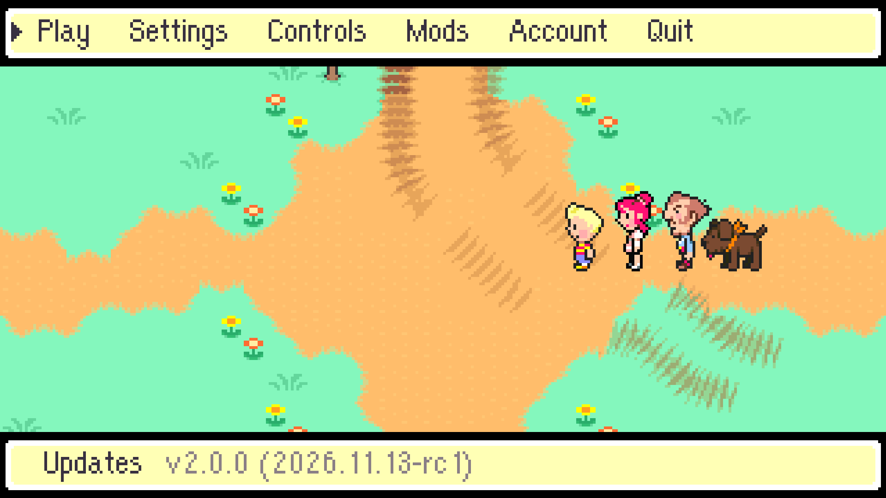
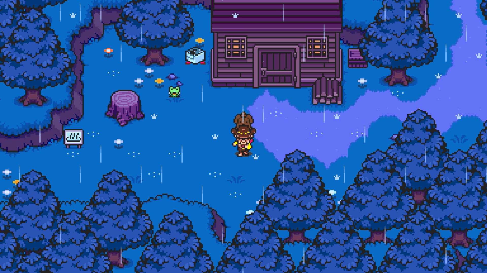
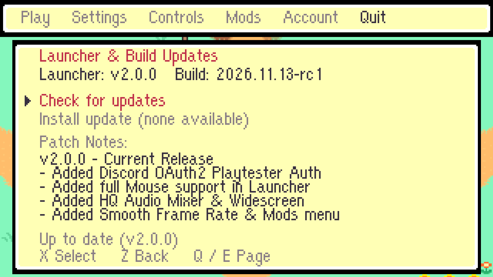
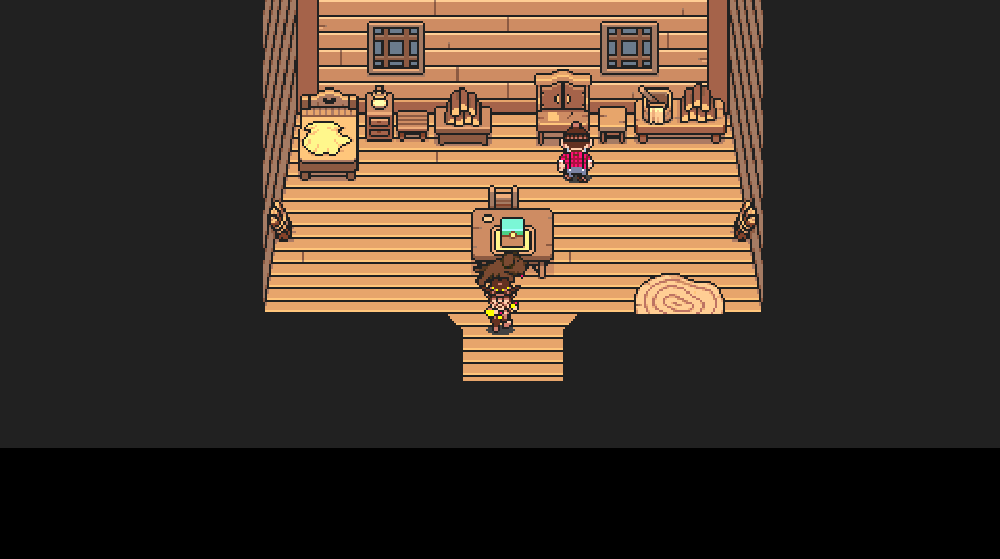
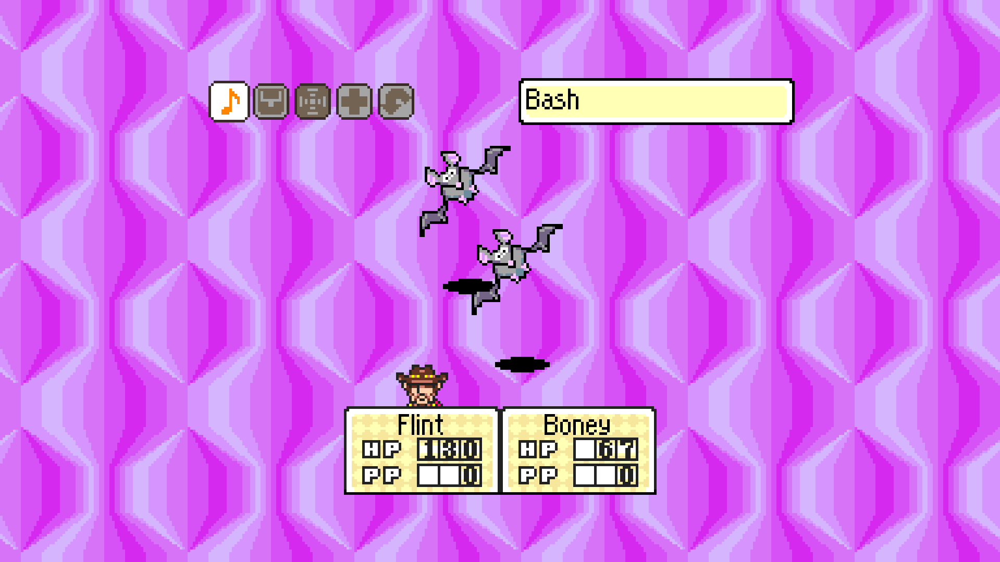
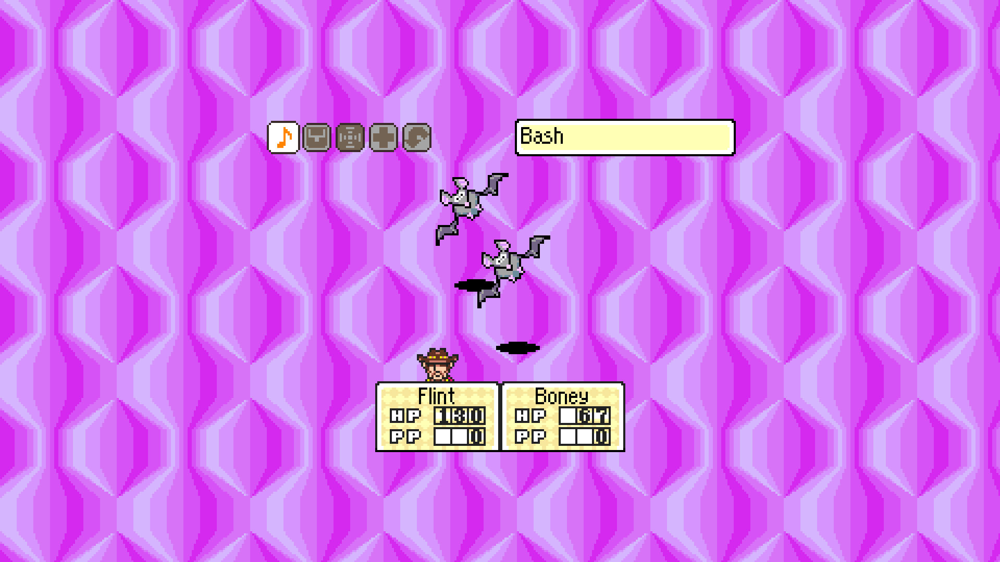

# MOTHER 3 Recomp

The previous MOTHER 3 port (by josiahg2502-glitch) but continued by me!
AI was used to assist in the coding within gbarecomp and recomp-ui.

YOU HAVE to provide your own gba.bin and rom! (seems like the best way to do it is to get a Japenese rom and manually translate it)

If you download the APK, it says that the BIOS (gba.bin) file is optional. IT IS NOT! You still have to get that file! I will go in and fix that later.

## Download

| Platform | Version | Download |
| --- | --- | --- |
| Windows x64 | 2.0.0 | [Windows ZIP](https://github.com/xXGhostPantsXx/Mother3PC/releases/download/v2.0.0/Mother3Recomp-Windows-x64.zip) |
| Linux x86_64 / Steam Deck | 2.0.0 | [Linux archive](https://github.com/xXGhostPantsXx/Mother3PC/releases/download/v2.0.0/Mother3Recomp-Linux-x86_64.zip) |
| Android (ARM64 and x86_64) | 2.0.0 | [Android APK](https://github.com/xXGhostPantsXx/Mother3PC/releases/download/v2.0.0/Mother3Recomp-Android.apk) |
| MacOS | 2.0.0 | [Mac file](https://github.com/xXGhostPantsXx/Mother3PC/releases/download/v2.0.0/Mother3Recomp-macOS.zip) |
| IOS (15 or higher) | 2.0.0 | [IOS IPA](https://github.com/xXGhostPantsXx/Mother3PC/releases/download/v2.0.0/Mother3Recomp-iOS.ipa) |

**v2.0.0:** Fixed the issues regarding audio and refresh rate. Added new options to the launcher for the ability to detect and automatically update your game! More patch notes are added within the launcher itself.

## Features

- An extended launcher that allows you to connect to Discord
- On-screen buttons in the game's text match your controller (Xbox, PlayStation or Nintendo) or keyboard
- Controls page for keyboard and controller along with new mouse controls
- Mods: drop `.ips`, `.bps` or `.ups` patches in the `mods` folder and tick them in the launcher
- Widescreen support and the ability to increase FOV
- Window flavors, display, scaling and screen-color options
- Built-in high-quality audio mixing
- Playtester builds
- A dedicated Discord server
- Updated Mac port and the addition of an IOS port

## Screenshots

| MOTHER 3's own launcher | Widescreen in Tazmily |
| --- | --- |
|  |  |
| --- | --- |
|  |  |
| **Widescreen fields** | **Widescreen rooms** |
|  |  |
| --- | --- |
|  |  |

## Instructions

1. Download your chosen file and extract it somewhere on your system
2. If on PC, it will open a prompt for you to choose your own gba.bin and rom file
3. If on IOS, navigate to your system's Files app; look for "On my iPhone"; find "Mother3Recomp"; place your gba.bin file in "bios" and rom in "roms"
4. Hit play or edit the game's settings through the launcher (in-game settings can also be changed by pressing "Esc" while playing)

## Planned Updates

- Local and online co-op
- Local and online pvp mode with shop system with the ability to pick your character
- A music box on the launcher and in-game
- Art gallery (user art, concepts, my own WIP images)
- GBA filter
- Fixes relating to in-game settings
- Option to change logo to "Earthbound 2" (the logo will be made by me)
- Other user suggestions!

## Join the Discord!
https://discord.gg/38UBd8wJ2J

[Credits](CREDITS.md) · [License](LICENSE)
